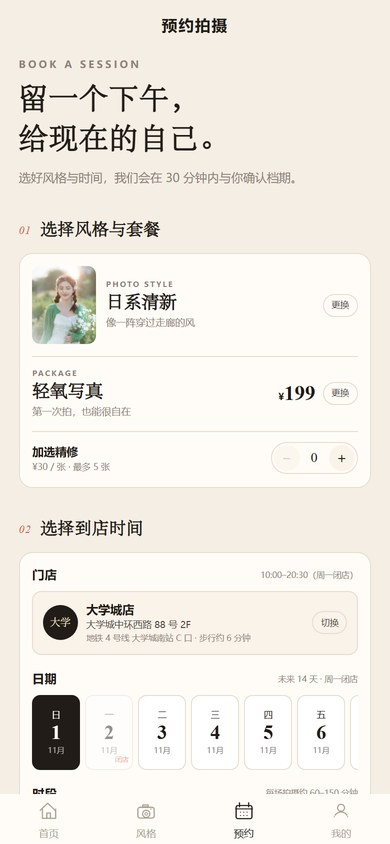
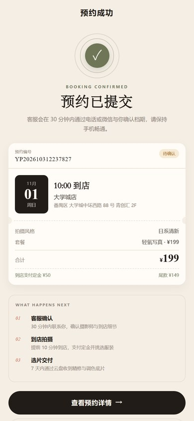
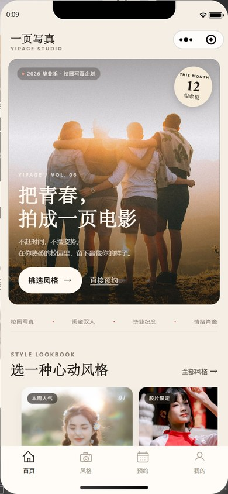
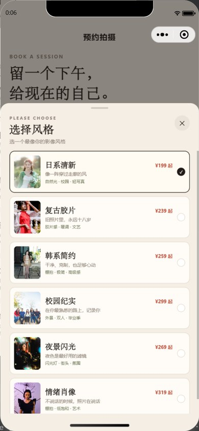
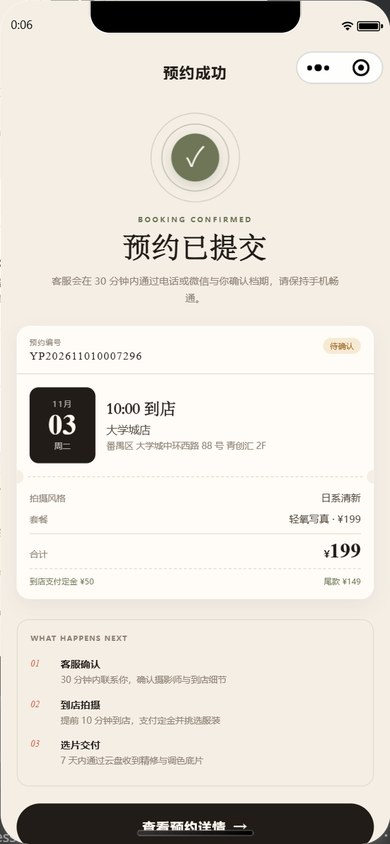

# 一页写真 · YIPAGE

一个可以用 **HBuilderX** 直接打开运行的 uni-app（Vue 3）微信小程序原型，面向大学生的校园写真预约场景。

主要流程：**选照片风格 → 选价格套餐 → 选门店 / 日期 / 到店时段 → 填写联系方式 → 提交预约 → 查看预约详情**。

> 这是前端原型：预约记录保存在本机缓存中，未接入后端、微信支付与短信服务。首次启动会写入 2 条演示预约，可在「我的 → 清空本机预约」中删除。

## 先看效果

| 首页 | 风格 | 预约 | 预约成功 |
| --- | --- | --- | --- |
|  |  |  |  |

<sub>上表来自 uni-app H5 渲染。下面是微信开发者工具模拟器中的实际运行截图：</sub>

| 微信端首页 | 预约弹层（TabBar 自动收起） | 预约成功 |
| --- | --- | --- |
|  |  |  |

---

## 1. 功能一览

| 模块 | 已实现 |
| --- | --- |
| 首页 | 品牌 Hero、风格推荐、套餐价格、拍摄流程、客片评价、双门店信息 |
| 风格 | 6 种写真风格、分类筛选、风格详情、场景/适合人群、色卡与拍摄手记 |
| 套餐 | 3 档价格套餐（轻氧写真 / 一页主角 / 双人纪念），时长、人数、精修、底片、定金 |
| 预约 | 风格/套餐/门店切换、未来 14 天日期、6 个时段、已约满状态、加选精修、表单校验、价格明细 |
| 订单 | 状态筛选、预约详情、取消预约、再次预约、复制门店地址 |
| 我的 | 预约统计、拍摄须知手风琴、联系客服、关于品牌、清空本机数据 |
| 体验 | 自定义导航、TabBar、底部选择弹层、空状态、加载态、Toast、响应式 rpx 布局 |

没有“假按钮”：页面内所有入口都有对应的页面、弹层或反馈。

---

## 2. 在 HBuilderX 中运行（推荐）

### 2.1 导入项目

1. 打开 HBuilderX。
2. 选择 **文件 → 导入 → 从本地目录导入**。
3. 选择本目录 `yipage-photo`（包含 `manifest.json`、`pages.json` 的这一层）。
4. 导入后，项目树中应能看到 `pages`、`components`、`static`、`App.vue`、`pages.json`、`manifest.json`。

> HBuilderX 运行 uni-app 使用内置编译器，**不需要执行 npm install**。项目里的 `package.json`、`vite.config.js` 只用于命令行 H5 预览，HBuilderX 可以忽略。

### 2.2 配置微信开发者工具

1. 安装并打开一次 **微信开发者工具**，开启「设置 → 安全设置 → 服务端口」。
2. 在 HBuilderX 中选择 **工具 → 设置 → 运行配置 → 小程序运行配置**，填写微信开发者工具的安装路径。
3. 在 `manifest.json` 中打开 **微信小程序配置**，把 `appid` 改成你自己的小程序 AppID。
   - 当前为 `touristappid`，用于游客/本地调试；正式上传前必须替换。
   - 没有 AppID 时，也可以在微信开发者工具里选择「测试号」进行本地预览。

### 2.3 运行

1. 在 HBuilderX 顶部菜单选择 **运行 → 运行到小程序模拟器 → 微信开发者工具**。
2. 首次运行如果提示安装插件（uni-app 编译器 / 内置浏览器），按提示安装即可。
3. 微信开发者工具打开后，即可在模拟器中体验完整流程。

> 如果 HBuilderX 提示“未检测到 uni-app 项目”，请确认导入的是 `yipage-photo` 文件夹本身，而不是它的上级目录。

### 2.4 直接导入已构建版本（最快看效果）

随项目附带的 `yipage-photo-mp-weixin.zip` 是已经编译好的微信小程序代码：

1. 解压 `yipage-photo-mp-weixin.zip`。
2. 微信开发者工具 → **导入项目** → 选择包含 `app.json` 的文件夹。
3. AppID 选择 **无 AppID** 或 **测试号**。
4. 点击导入，等待编译完成即可体验。

> 当前 `project.config.json` 使用 `touristappid`。微信开发者工具的 `cli open --project` 不接受 `touristappid`，所以请使用图形界面的“导入项目”，不要用 `cli open`。

---

## 3. 命令行预览（可选）

需要 Node.js 20+。

```bash
cd yipage-photo
npm install
npm run dev:h5
# 浏览器打开 http://127.0.0.1:5178
```

构建微信小程序：

```bash
npm run dev:mp-weixin
# 产物在 dist/dev/mp-weixin
```

然后在微信开发者工具中导入 `dist/dev/mp-weixin`。正式构建用：

```bash
npm run build:h5
npm run build:mp-weixin
```

---

## 4. 目录结构

```text
yipage-photo/
├─ App.vue                 # 全局样式与启动时写入演示预约
├─ main.js                 # Vue 3 入口
├─ manifest.json           # 应用配置（含微信 AppID）
├─ pages.json              # 页面路由、TabBar、自定义导航
├─ index.html              # H5 预览入口
├─ vite.config.js          # CLI 预览配置；HBuilderX 不需要
├─ common/
│  ├─ data.js              # 风格、套餐、门店、时段、评价等演示数据
│  ├─ date.js              # 日期格式化、未来 14 天档期
│  ├─ booking.js           # 预约草稿、时段可用性
│  └─ order.js             # 本机订单存储、状态、演示数据
├─ components/
│  ├─ yp-nav-bar.vue       # 自定义导航栏
│  ├─ yp-style-card.vue    # 风格卡片
│  ├─ yp-package-card.vue  # 套餐卡片
│  ├─ yp-section-head.vue  # 区块标题
│  ├─ yp-sheet.vue         # 底部选择弹层
│  └─ yp-empty.vue         # 空状态
├─ pages/
│  ├─ index/index.vue      # 首页
│  ├─ styles/list.vue      # 风格列表
│  ├─ styles/detail.vue    # 风格详情
│  ├─ packages/list.vue    # 套餐与价格
│  ├─ booking/create.vue   # 预约表单
│  ├─ booking/success.vue  # 预约成功
│  ├─ orders/list.vue      # 我的预约
│  ├─ orders/detail.vue    # 预约详情
│  ├─ mine/mine.vue        # 我的
│  └─ mine/guide.vue       # 拍摄须知
└─ static/
   ├─ images/              # 本地照片（不依赖外部图床）
   └─ tabbar/              # TabBar 图标
```

---

## 5. 业务规则（演示版）

- **档期**：未来 14 天，周一闭店；每天 6 个时段：10:00 / 11:30 / 14:00 / 15:30 / 17:00 / 18:30。
- **约满状态**：由 `date + time + store` 的稳定哈希模拟，约 1/6 的时段显示“已满”。规则在 `common/booking.js` 的 `isSlotAvailable` 中，可在接后端时替换为接口返回。
- **价格**：套餐价 + 加选精修（¥30/张，最多 5 张）；定金按套餐固定（¥50 / ¥100 / ¥150），尾款到店支付。
- **预约状态**：
  - `pending` 待确认：用户刚提交；
  - `upcoming` 待拍摄：演示数据中的已确认预约；
  - `completed` 已完成；
  - `canceled` 已取消。
- **订单存储**：`uni.setStorageSync('yipage_orders_v1', orders)`，仅保存在当前设备/当前微信账号的本地缓存。
- **演示数据**：首次启动写入 2 条带 `DEMO` 标记的预约，方便查看列表、详情和状态样式。

---

## 6. 想改成自己的店

1. **品牌与联系方式**：修改 `common/data.js` 里的 `STUDIO_INFO`。
2. **风格与价格**：修改 `STYLES`、`PACKAGES`、`STORES`、`TIME_GROUPS` 即可；页面会自动渲染。
3. **照片**：替换 `static/images/` 下的同名 JPG（建议 3:4，600×800 以上）。
4. **主题色**：修改 `App.vue` 顶部的 CSS 变量（`--ink`、`--accent`、`--bg` 等）。
5. **AppID**：修改 `manifest.json` → `mp-weixin.appid`。
6. **接后端**：把 `common/order.js` 中的 `getOrders`、`createOrder`、`cancelOrder` 替换为 `uni.request`；把 `isSlotAvailable` 换成档期接口；支付可在提交预约后调用 `uni.requestPayment`。

---

## 7. 已验证

- `npm run build:h5` 编译通过。
- `npm run build:mp-weixin` 编译通过，微信小程序产物约 **964 KB**（主包小于 2 MB）。
- 在 H5 预览中实际走通：切换风格 / 套餐 / 门店 → 选择日期时段 → 填写表单 → 提交预约 → 成功页 → 订单详情 → 取消预约 → 再次预约 → 清空本机数据 → 空状态。
- 在 **微信开发者工具模拟器** 中实际走通：选风格弹层 → 填写称呼/手机号/微信/备注 → 勾选预约须知 → 提交预约 → 成功页 → 预约详情；同时验证了弹层打开时自动隐藏原生 TabBar、固定导航在滚动时不被状态栏遮挡。
- 控制台无运行时报错。
- HBuilderX 5.34 已安装并可将本项目识别为 **UniApp_VUE** 项目；微信开发者工具已安装并登录。

> **环境备注（2026-10-31）**：
> 1. 本机 HBuilderX 5.34 的 CLI `launch web / launch mp-weixin` 对 uni-app 项目会误报“不是 uni-app 项目”，HBuilderX 自己新建的模板项目也一样；这是该版本 CLI 的问题，请在 HBuilderX 图形界面中按第 2 节运行。
> 2. 微信开发者工具的 CLI `open --project` 不接受 `touristappid`，会报“不存在此 AppID”。请用图形界面导入，并在 AppID 处选择 **无 AppID / 测试号**；已附 `yipage-photo-mp-weixin.zip` 方便直接导入。
> 3. 真机预览或上传前，请换成自己的小程序 AppID。

照片来源与授权说明见 [ASSETS.md](./ASSETS.md)。本项目仅用于学习与作品演示，请替换为自有客片后再用于商业用途。
